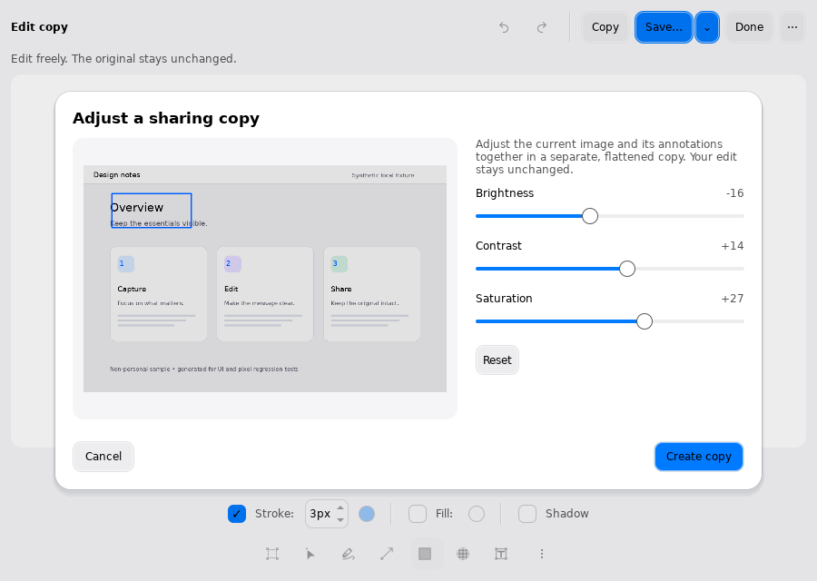
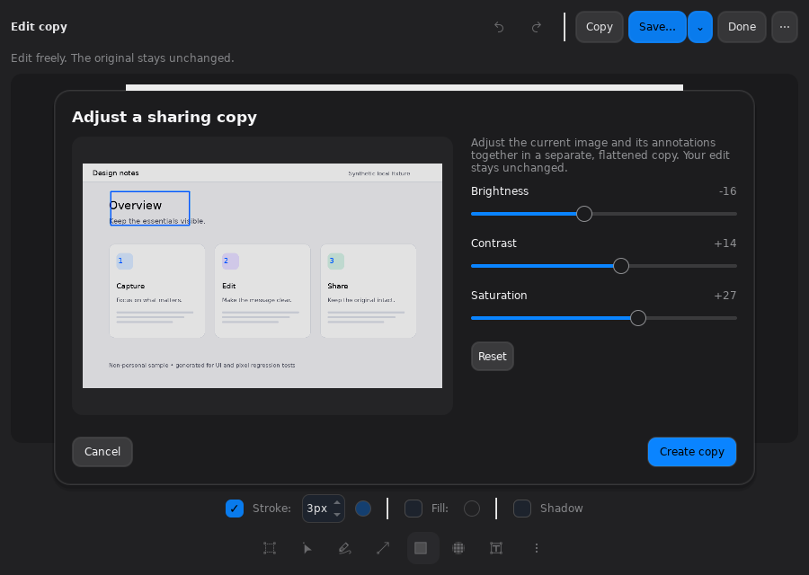
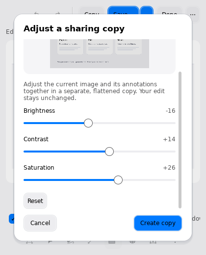
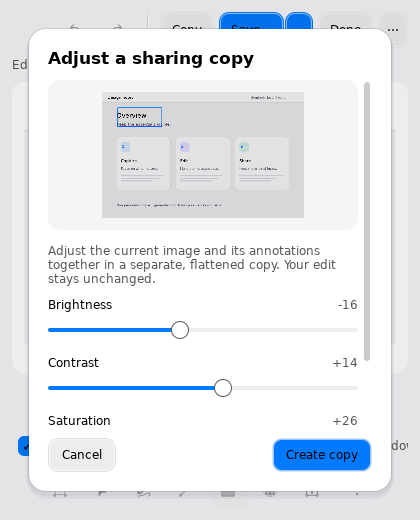

# Light and color for an independent image copy (109)

In the independent image editor, choose **More → Adjust light and color…**.
Three sliders control brightness, contrast and saturation; a bounded preview
updates while the original edit session stays untouched. Reset returns all three
to zero. Cancel or Escape discards this preview; reopening starts at zero.
**Create copy** produces an independent full-resolution image pin using the
captured revision. Copy, PNG save, OCR and further editing remain available from
that pin. This is not an editable adjustment layer or a saved photo project.

The entry is deliberately secondary, outside the permanent annotation toolbar.
The wide popup uses preview/controls columns; compact windows use a scrolling
body with fixed Cancel/Create controls. The image and annotations are explicitly
flattened and adjusted together. Video annotation mode does not expose this tool.

## Processing contract and reuse

`Imaging/ImageAdjustments` is independent of the window, global screenshot
state and KQuickImageEditor. It does not use upstream applyColorAdjustment.
Valid inputs are bounded to 40 million pixels, 8192 wide and 32000 tall. All
parameters are integer -100…100. Zero parameters produce an exact detached copy
with source format/profile/DPR retained. Nonzero parameters convert to encoded
sRGB8, preserve alpha, physical dimensions and DPR, and never mutate source bytes.
Unprofiled input is assumed sRGB; this is not HDR or professional raw processing.

For each normalized RGB channel, brightness adds brightness/100; contrast scales
around 0.5 by 1+contrast/100, followed by clamping. Saturation interpolates from
Rec709-weighted grayscale by 1+saturation/100, then clamps and rounds to bytes.
Fully transparent output RGB is zero. This is a documented lightweight image
adjustment, not exposure stops, linear-light grading or an AI enhancement.

The preview keeps an immutable full-size snapshot, normalizes once to sRGB and
scales its longest edge to at most 1024. The same adjustment helper processes
preview and output; small-scale filtering/clipping may differ from the final
full-resolution result. Final work runs off the GUI thread. Create captures its
options/source before popup cleanup; repeated submissions are refused while busy.
The editor is temporarily disabled during preview/output and retains its original
undo stack and unsaved-change status. No files are written or uploaded by Create.

## Acceptance boundary

All previews and controls are actual Qt software windows, not design mockups.
Native KDE portal/monitor color profiles, HDR, GPU and physical-device input remain
separate acceptance work. No new native capture or recording claim is made;
translation remains paused.

## Verified UI review

The production build and focused algorithm/preview tests pass. Actual Qt mouse
and keyboard workflows pass in light, dark and 420×520 windows: all sliders,
Reset, Cancel/Escape and clean reopen, Copy/Save exclusion, duplicate submission
rejection, full-resolution output pixels and original document/history/dirty-state
preservation. A separate code review found no blocking integration defect.

Initial screenshots exposed square native slider handles and excess wide-layout
whitespace. The reviewed revision uses thin tracks/circular handles and a shorter
wide popup. Compact screenshots show both the preview and scrolled controls,
with the action footer always reachable. These are software-window captures.

Final verification: CTest **32/32** passed in 188.90 seconds; static checks **34/34**. Existing independent-editor PNG/JPEG/WebP save, comparison/navigation, returned-window GC lifetime, local Open/playback/clip workflows also pass. No remote CI success is inferred from these local results.
