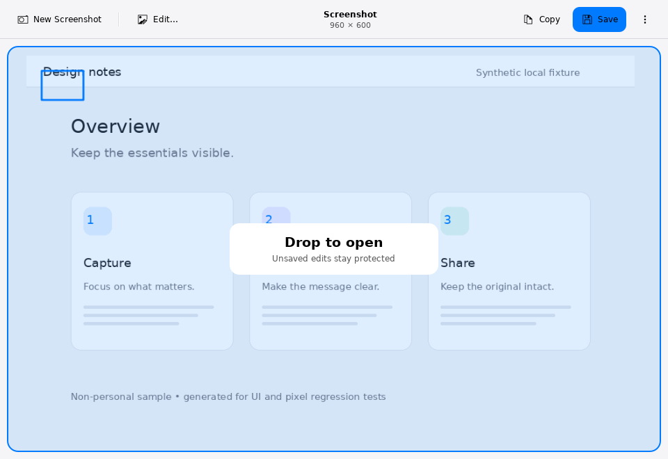
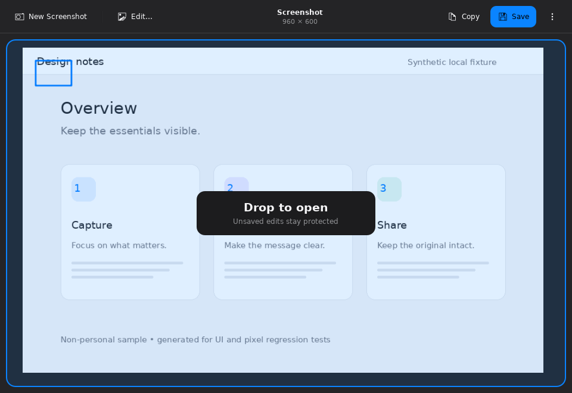
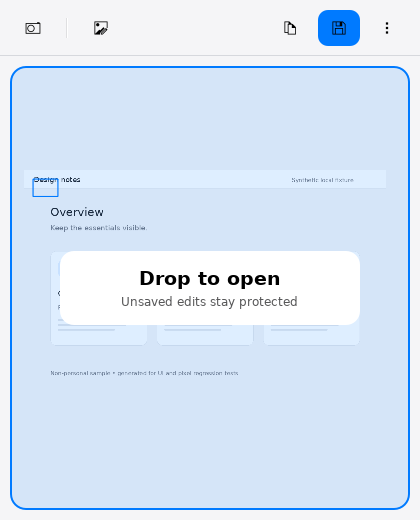

# Drop an image or recording into NkShot (108)

Drag one local PNG, JPEG, static WebP, supported MP4 or WebM onto the main viewer.
Only while a supported file is over the viewer, a quiet accented frame says
“Drop to open”. There is no new permanent toolbar command. The ordinary Open and
Recent files routes remain available, including keyboard access.

## No implicit move or replacement

The target accepts only the **Copy** drag action. Move-only drags, multiple files,
plain text, remote URLs and other formats are not accepted. Successful drop
admission means an open request started, not that the file has decoded or replaced
anything. Existing content still goes through the normal replacement confirmation,
with Cancel as the default. Hovering reads no file and starts no media decoder.

The same LocalMediaLoader validates file identity, dimensions, formats and media
limits after Drop. Corrupt, missing, oversized and unsupported actual contents
fail without replacing the document. No URL is downloaded or converted from a
remote address to a local path. URL query/fragment, host/user info and relative
paths are refused. The policy operates on Qt's parsed QUrl values; it is not a
separate parser for raw URI-list bytes.

Drop admission is rechecked on movement and release. Capture/recording, other open
operations, native modal dialogs and active clip editing block it; known viewer
popups also disable the target. The cue clears on leaving, hiding, becoming busy
or changing source. Source files are not moved or deleted. Deliberately saving
later is a separate existing action.

## Reuse and acceptance

MediaDropPolicy is a small QtCore-only lexical helper, and MediaDropTarget receives
its admission/open callbacks from the owner. It does not reach into the screenshot
document. No editing/capture capabilities are replaced; translation is unchanged.

Synthetic Qt drag events sent through the actual window and QML DropArea can
verify admission, cue state, copy-action negotiation and the real validation/
replacement workflow. They do not certify native Dolphin/Wayland/X11 or portal
drag negotiation, physical pointer behavior, live recording or KDE permissions.

## Verified review

The current production and test binaries compile. All 38 policy QtTest results
and 33 static checks pass. Actual Qt platform drag/drop events pass in light,
dark and 420×520 software windows, including Shift (move proposal) negotiated to
Copy, hover/leave, busy chooser, Cancel/Discard, corrupt/missing-file recovery,
exact PNG pixels and MP4 playback transition without source-file changes.
The screenshots were visually reviewed: the transient centered cue fits all three
sizes, uses existing theme colors and leaves the permanent toolbar unchanged.

The new test initially retained a raw ViewerWindow pointer after successful Open,
which intentionally rebuilds that window. The helper now reacquires the singleton
and verifies old-window destruction with QPointer; all three complete reruns pass.
This was a test lifetime defect, not evidence of a published product regression.
A separate read-only review found no blocking issue in policy, owner or QML flow.
Native desktop drag sources, portals, focus/physical monitors and recording devices
remain unaccepted. Translation remains paused.

Full regression: CTest **30/30 passed** in 179.00 seconds.
Existing normal Open/Save/playback/clip UI regression also passed unchanged.
