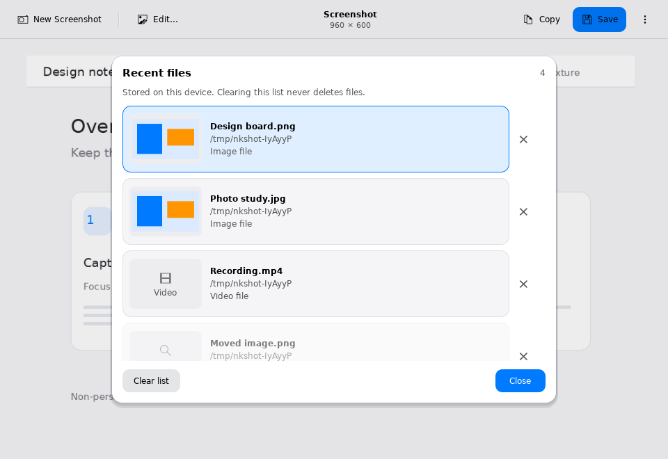
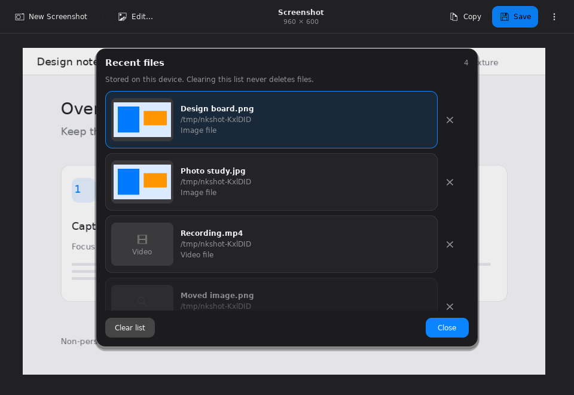
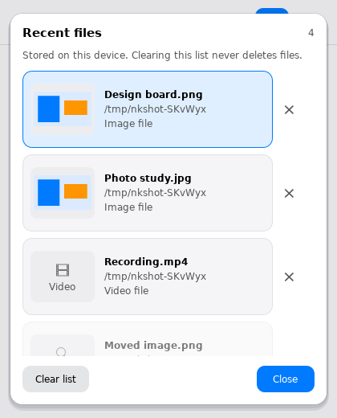

# Visual recent files (110)

**More → Recent files** now uses image previews and compact file cards, so saved
screenshots are easier to recognize without opening each one. The list remains
limited to twenty explicitly opened or saved local files. It is not an automatic
capture archive, a directory scanner or a clipboard history.

Images keep their complete aspect ratio inside the preview tile. Video rows use
an honest video icon/type instead of claiming a decoded video frame. Missing or
unsupported images use placeholders. The original filename and folder remain
visible, with middle elision at narrow widths. Up/Down and Enter preserve the
existing keyboard workflow. Opening still uses the same loader and unsaved-edit
replacement confirmation. Remove and Clear list affect metadata only, never the
media file. A failed thumbnail does not prevent a normal validated Open attempt.

## Bounded local preview session

The `Imaging/MediaThumbnail` helper reads regular local PNG/JPEG/static WebP only.
It rejects remote URLs, URL queries/fragments, symbolic links, special files,
animation and unsupported actual formats. Source input is bounded to 64 MiB,
40 million pixels and 32768 per axis. It opens with no-follow/nonblocking flags,
reads bounded bytes into an in-memory buffer, validates the decoded header and
checks device/inode/size/mtime/ctime before and after processing. Same-UID pathname
races are not an atomic filesystem transaction; parent directories are not sealed.

Thumbnail output is at most 160 pixels on the longest edge, without enlargement,
with alpha retained and sRGB/DPR1 display normalization. Source files are never
modified. There is no disk thumbnail cache, media upload or external provider.

A viewer-owned `RecentThumbnails` session starts only when Recent files opens.
A dedicated single-worker pool bounds image decoding across replaced viewers.
Closing/clearing invalidates generations and releases session/provider images;
queued cancelled requests skip reading and in-flight results are ignored. An
already-running image codec cannot be forcibly interrupted; its resource limits
are not a hard wall-clock timeout. Reopening rechecks files and creates a new
preview generation. Qt's own rendering resources follow normal Qt lifetimes;
this is not a secure memory-erasure guarantee.

## Acceptance boundary

Actual software-window checks and generated local file tests do not certify native
KDE portals, Dolphin integration, GPU/HDR/display profiles or live capture. No
native recording or full 1Capture parity is claimed. Translation remains paused.

## UI review

The application compiles, and the actual Recent menu workflow passes in light,
dark and 420×520 software windows. The three screenshots were visually inspected:
file identity remains readable, full-aspect image tiles are distinct from video/
missing placeholders, focused rows are obvious, and Close/Clear remain fixed.
The list scrolls instead of squeezing all records into the small window.

Verification: full CTest **34/34** passed (243.12 s), static checks **35/35**.
After the final theme-border correction and synchronous-observer lifetime guard,
all three affected model/decoder/cache targets and the actual popup flow passed
again. The three polished UI variants and original recent-file reopen/clip
workflow also passed. Tests explicitly allow an observer to destroy the session
during begin or asynchronous completion; no callback subsequently touches it.
The first build caught a C++ identifier issue, corrected before testing/publishing.
No remote CI success is inferred from local checks.
